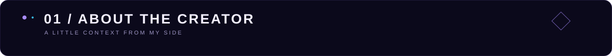
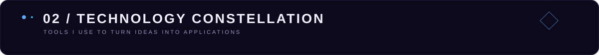
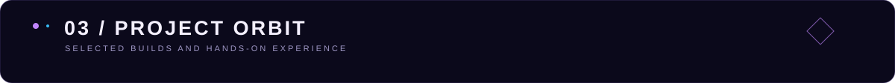
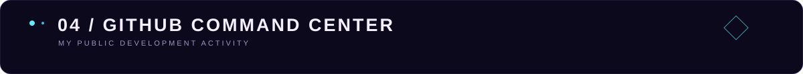
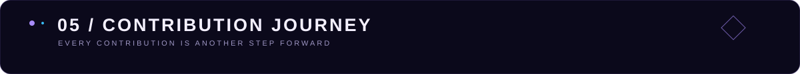
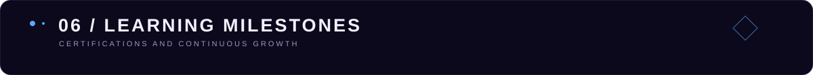

  

 

  

---

I'm **Pugalmani K**, an aspiring software developer focused on **UI/UX and MERN Stack development**. I enjoy building responsive, user-focused applications and continuously strengthening my skills through hands-on projects and problem-solving.

- 🎓 **M.Sc. Computer Science** — RVS College of Arts and Science, Sulur (2025–2027)
- 🎓 **B.Sc. Computer Science** — AG Arts and Science College, Avinashipalayam (Graduated 2025)
- 💻 Interested in full-stack web development, API development and secure application design
- 🧠 Practising Data Structures & Algorithms and Object-Oriented Programming
- 🌱 Continuously learning, experimenting and building

  

  

  

<table>
  <tr>
    <td width="50%" valign="top">
      <h3>🏦 Banking Application</h3>
      
A full-stack banking application developed with the MERN stack.

      <ul>
        <li>Secure user authentication</li>
        <li>Account management</li>
        <li>Money transfers</li>
        <li>Transaction history</li>
        <li>Responsive interface and backend API integration</li>
      </ul>
      
<b>Stack:</b> MongoDB · Express.js · React.js · Node.js

    </td>
    <td width="50%" valign="top">
      <h3>🌐 Personal Portfolio Website</h3>
      
A responsive personal website designed to present projects and technical skills.

      <ul>
        <li>Responsive web layout</li>
        <li>Project and skills showcase</li>
        <li>Built with core web technologies</li>
      </ul>
      
<b>Stack:</b> HTML · CSS · JavaScript

    </td>
  </tr>
</table>

  

  

  

<!-- Snake animation is generated by the GitHub Actions workflow in .github/workflows/snake.yml -->

  

- **C Basic Programming** — Simplilearn (2025)
- **Python for Beginners** — Simplilearn (2025)
- **MERN Stack Development** — App Innovation Technologies Pvt. Ltd. (2025)

**Thanks for visiting my corner of the digital universe.**  
*Let's connect, collaborate and create something meaningful.*

<a href="mailto:pugalmanikaruppusamy@gmail.com">✉️ pugalmanikaruppusamy@gmail.com</a>

